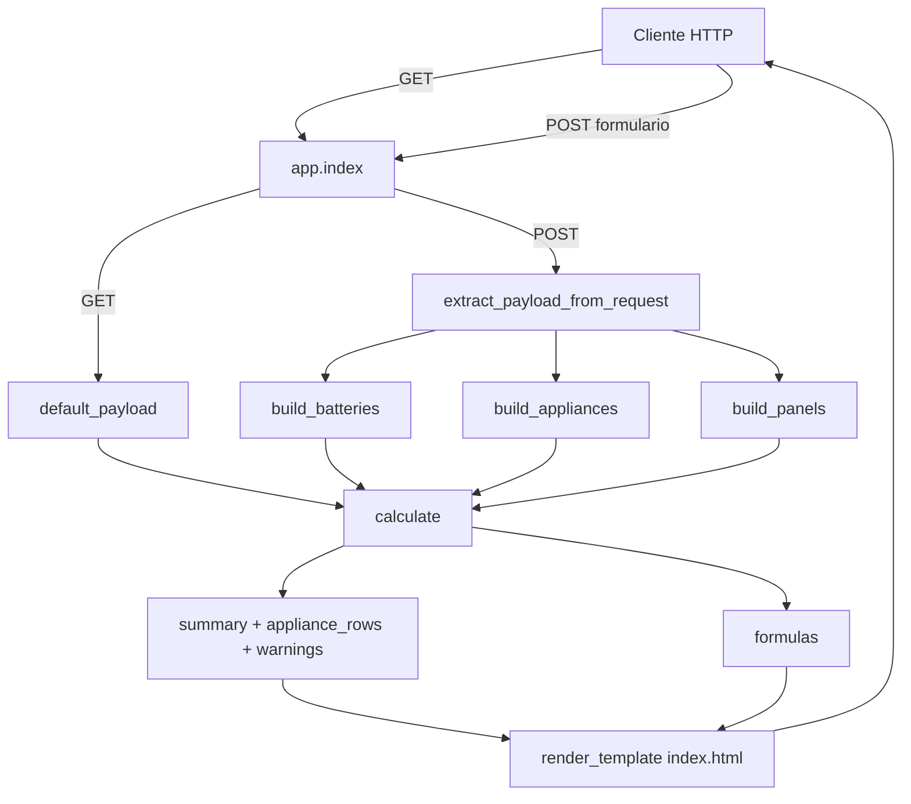

# power_calc — Simulador Solar & Baterías

Aplicación Flask con interfaz técnica oscura para modelar sistemas fotovoltaicos off-grid / híbridos. Calcula energía nominal, consumo, generación solar, balance energético y autonomía.

[](LICENSE)
[](https://python.org)
[](https://flask.palletsprojects.com)
[](https://github.com/bi0punk/power_calc/actions/workflows/ci.yml)

## Contenido

- [Características](#características)
- [Arquitectura](#arquitectura)
- [Stack](#stack)
- [Estructura del repositorio](#estructura-del-repositorio)
- [Instalación](#instalación)
- [Uso](#uso)
- [Configuración](#configuración)
- [Tests / CI](#tests--ci)
- [Fórmulas](#fórmulas)
- [Roadmap](#roadmap)
- [Licencia](#licencia)

## Características

- Cálculo de energía nominal y útil (AC) del banco de baterías.
- Consumo instantáneo y diario por carga/equipo.
- Generación solar útil diaria estimada (HSP × eficiencias).
- Balance energético diario solar vs. consumo.
- Autonomía: solo batería, por perfil diario, híbrida solar+batería.
- Advertencias automáticas ante parámetros inconsistentes.
- Interfaz dark técnica con Chart.js, badges de estado y diseño responsivo.

## Arquitectura



## Stack

- Python 3.11+
- Flask 3.1, Jinja2
- Chart.js, Bootstrap, JetBrains Mono (frontend)
- pytest y ruff (dev/CI)

## Estructura del repositorio

```
power_calc/
├── app.py                      # Lógica de cálculo + rutas Flask
├── templates/
│   └── index.html              # Interfaz de usuario
├── static/
│   └── custom.css              # Estilos personalizados
├── tests/
│   └── test_smoke.py           # Prueba de humo
├── .github/workflows/ci.yml    # CI (ruff + pytest)
├── requirements.txt
├── pyproject.toml
├── run.sh
├── .env.example
├── LICENSE
└── README.md
```

## Instalación

```bash
git clone https://github.com/bi0punk/power_calc.git
cd power_calc
python3 -m venv .venv && source .venv/bin/activate
pip install -r requirements.txt
```

## Uso

```bash
python app.py
```

Abrir `http://127.0.0.1:5000`. Ingresar datos de baterías, consumos y paneles solares, y presionar "Calcular" para ver los resultados.

```bash
# O usando run.sh
bash run.sh
```

## Configuración

Variables de entorno (ver `.env.example`):

| Variable | Default | Descripción |
|---|---|---|
| `SECRET_KEY` | (auto-generada) | Clave secreta Flask |
| `DEBUG` | `false` | Modo debug (`true`/`false`) |

## Tests / CI

```bash
pip install pytest ruff
pytest -q
ruff check .
```

El workflow `.github/workflows/ci.yml` instala con `uv`, configura Python 3.11, y ejecuta `ruff check .` y `pytest -q` en cada push y PR.

## Fórmulas

- `Wh_banco = Voltaje × Ah × Cantidad`
- `SOC_min = 100 − DOD`
- `fraccion_SOC = max(0, SOC_inicial − SOC_min) / 100`
- `Wh_util_AC = Wh_banco × fraccion_SOC × η_descarga × η_inversor`
- `Wh_solar_dia = W_paneles × HSP × η_solar × η_inversor`
- `Autonomia_h = Wh_util_AC / W_carga_total`
- `Autonomia_hibrida_dias = Wh_util_AC / |deficit_diario|`

## Roadmap

- [x] Cálculo de energía, consumo, generación solar, balance y autonomía
- [x] Interfaz dark con Chart.js y advertencias de parámetros
- [ ] Soporte para múltiples bancos de baterías con diferentes químicas
- [ ] Curvas de descarga personalizadas (Peukert)
- [ ] Simulación horaria con perfil de carga variable
- [ ] Exportación de resultados a PDF
- [ ] Almacenamiento de configuraciones (presets)

## Licencia

MIT
